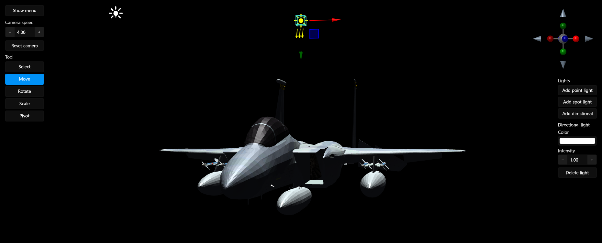
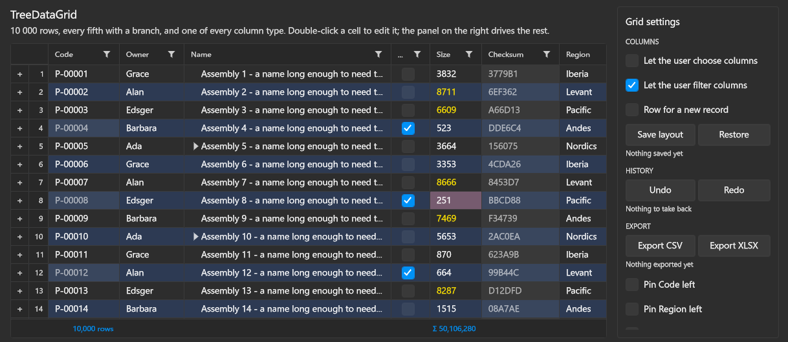
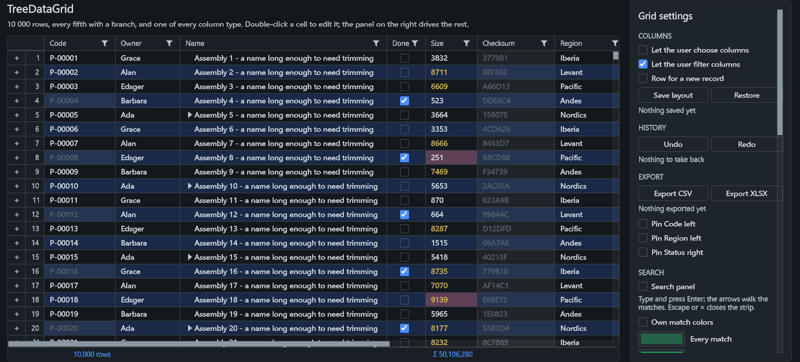
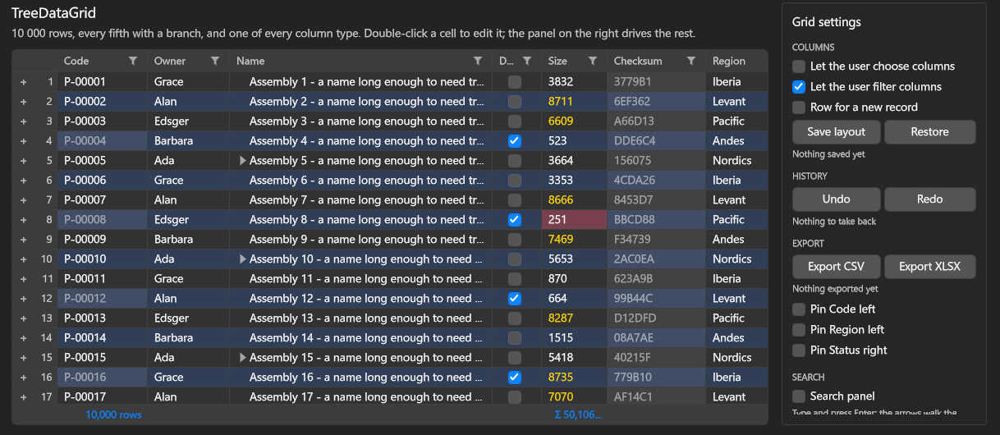

# Adamantium UI

[](https://github.com/AdamantiumStudio/AdamantiumUI/actions/workflows/ci.yml)
[](https://www.nuget.org/packages/Adamantium.UI)
[](https://github.com/AdamantiumStudio/AdamantiumUI/blob/main/LICENSE)

A .NET UI framework for desktop applications, on its own Vulkan renderer: a full set of controls up to docking, a
ribbon, a tree data grid, a property grid and an infinite canvas with a node graph; markup compiled to C#; styles and
live themes; MVVM and navigation built in - and a 3D scene that is an ordinary element of the markup, drawn by the same
renderer as the interface around it.

> **Alpha.** Windows and Linux (Wayland); macOS is planned. The API will change between releases. What changed since
> the first alpha: [CHANGELOG](https://github.com/AdamantiumStudio/AdamantiumUI/blob/main/CHANGELOG.md).



## At a glance

- **[Controls](#controls)** - from buttons and text boxes to [tabs](#tabs), [docking](#docking), a [ribbon](#ribbon),
  a [tree data grid](#data-grid), a [property grid](#property-grid) and an [infinite canvas](#infinite-canvas-and-node-graph).
- **[Shapes and vector graphics](#shapes-and-vector-graphics)** - paths, Bézier curves, B-splines and NURBS with dashed
  strokes, drawn on the GPU.
- **[Brushes, materials and effects](#brushes-materials-and-effects)** - gradients, mesh gradients, noise, fractals,
  acrylic, mica and liquid glass, shadows and auras.
- **[Animations and transitions](#animations-and-transitions)** - eased animations started from triggers, sliding
  content.
- **[Markup, styles and themes](#markup-styles-and-themes)** - AUML compiled to C#; three themes, light and dark,
  switched live.
- **[Data binding and MVVM](#data-binding-and-mvvm)** - bindings of every kind; view-models with generated properties
  and commands.
- **[Navigation](#navigation)** - regions, a navigation journal, dialogs and windows driven from view-models.
- **[Localization](#localization)** - strings in language files with plurals and selections, `{Localize}` in markup,
  and the language switched while the application runs.
- **[Input and drag and drop](#input-focus-and-drag-and-drop)** - keyboard focus, touch and pen, input methods, drag
  and drop inside the application and with other applications; accessibility for screen readers.
- **[A 3D scene in the markup](#a-3d-scene-in-the-markup)** - an engine scene as an element of the tree, with no
  airspace and no copy of the frame.
- **[Tooling](#tooling)** - `dotnet new` templates and a Rider plugin with a live preview.

## Controls

| | |
|---|---|
| **Buttons and toggles** | `Button`, `RepeatButton`, `ToggleButton`, `CheckBox`, `RadioButton`, `ToggleSwitch`; `DropDownButton` whose items are actions, `SplitButton` and `ToggleSplitButton`; `SegmentedControl` - a few choices, all in sight |
| **Text** | `TextBlock`, `TextBox`, `PasswordBox` - see [Text](#text) |
| **Numbers and ranges** | `NumericUpDown` for integers or decimals, `Slider`, `RangeSlider` with two thumbs, `ScrollBar` |
| **Date and time** | `Calendar` with month, year and decade views; `DatePicker`, `TimePicker`, `DateTimePicker`; `DateTimeField` and `DurationField` typed part by part; `Clock` with hands or in figures, `CountdownTimer`, `StopwatchTimer` with laps |
| **Progress and status** | `ProgressBar`, `RingProgressBar`, `BusyIndicator`; `Badge` with a count or a dot; `StatusBar` |
| **Lists and trees** | `ListBox` and a virtualized `TreeView`, each with single, multiple or extended selection; `DropDown`; `DataPager` with arrows, page numbers, a page-size picker and a page box |
| **Menus and pop-ups** | `MenuItem` with nested menus, `ContextMenu`, `ToolTip`, `Popup`, `Expander` |
| **Color** | `ColorPicker` with RGB, alpha and hex, `ColorPickerButton`, `ColorWheel`, `ColorPalette` as in a font color menu |
| **Images** | `Image`, nine-slice images; `IconPresenter` for an icon of path data, a glyph or an image |
| **Tiles** | `TilesHost` and `FlipTile`: a board of 3D tiles that tilt toward the pointer and flip on click |

### Tabs

`TabControl` for editors and browsers:

- the tab strip on any side - top, bottom, left or right - with an inner or outer selection indicator;
- pinned tabs, in a row of their own or in the same row;
- tear-off: a tab dragged out of its strip asks for a window of its own;
- an overflow menu, a scrolling strip, and a virtualized strip for a great many tabs;
- close buttons, and content that slides left, right or up on switching.

### Docking

A docking workspace in the manner of Visual Studio:

- document and tool panes in tabbed groups, split in any direction;
- a drop compass that docks a dragged pane to any side or into a group;
- panes torn off into floating windows and docked back;
- groups collapsed to the window edge and revealed on demand;
- layouts saved and restored;
- events for closing, restoring and tearing off panes; closing and tearing off can be cancelled.

### Ribbon

An Office-style ribbon:

- tabs and groups that shrink step by step and collapse as the window narrows;
- large, medium and small buttons, split buttons, drop-down buttons, toggle buttons and galleries;
- contextual tab groups;
- a quick access toolbar above or below the ribbon, and an application menu;
- key tips: press Alt and type the letters shown.

### Data grid

`TreeDataGrid` shows flat lists and trees in one control:

- sorting by several columns, shown as chips in a sort panel;
- grouping by dragging columns to a group panel;
- filters on every column and a search panel;
- totals and aggregates in a footer;
- columns frozen on the left and right, a column chooser, and a column layout that can be saved;
- cell or full-row selection;
- editing in place, a new-row line, row validation rules and undo;
- row details and row headers;
- cell states derived from values, for the theme to style ("over the limit", "settled");
- export to CSV and XLSX.

### Property grid

`PropertyGrid` is an inspector:

- names and values split by a draggable grip, in folding sections;
- several objects inspected at once: the common value is shown, differing values are marked, and an edit writes to
  every object;
- every write is reported with all its targets, ready for undo.

### Infinite canvas and node graph

`InfiniteCanvas` is the plane under two controls, `DrawingBoard` and `NodeGraph`:

- an unbounded plane with pan and zoom, a minimap and a view bar;
- `DrawingBoard`: pen, shapes, curves, paths, text, images and an eraser, with selection handles, transforms and
  alignment;
- `NodeGraph`: nodes with typed sockets, wires, groups and a node palette. The graph is kept evaluated while it is
  edited: only changed nodes are recomputed, in dependency order;
- an inspector and an undo history;
- SVG import and export; scenes and graphs saved and loaded.

### Windows, overlays and pop-ups

- `Window` with its own title bar, caption buttons on the right or on the left, and commands in the title bar.
- `OverlayWindow`: windows inside a window, for dialogs and tool windows.
- `SlidePanel`: a panel that slides in over the content from any edge of the window, animated, taking no layout space.
- `SplashWindow`: shown at once while the application starts, on a thread of its own, and while it opens a document.
- Modal dialogs, a limit on how many copies of the application run, per-monitor DPI and each monitor's refresh rate.

### Layout

- Panels: `Grid` with `GridSplitter`, `StackPanel`, `WrapPanel`, `DockPanel`, `UniformGrid`, `Canvas`, and virtualizing
  panels for long lists.
- `TiledPanel`: tiles in a tree of regions, a new one dragged out of a tile's corner, with the usual layouts
  ready-made.
- `ScrollViewer`, `Viewbox`, `Border`, and `RevealDecorator`, which shows a growing part of its child.
- `ZoomBox`: a zoom and pan viewport - the wheel zooms toward the cursor, dragging pans, and the scale and offset are
  bindable.
- `RenderTargetPanel` for a [3D scene](#a-3d-scene-in-the-markup).

### Text

- Its own font stack: TrueType, OpenType with CFF and CFF2, font collections, WOFF and WOFF2. Glyphs are drawn from
  MSDF atlases, sharp at any scale, with OpenType kerning.
- `TextBlock`: wrapping, trimming, horizontal and vertical alignment, justification, and outlined text; rich text of
  `Bold`, `Italic`, `Underline`, `Span`, `Hyperlink`, `Ruby`, paragraphs and elements inline; text set inside any
  shape (`Shape`) or flowing round one, and on into another block (`TextBlockOverflow`); `TextOnPath` along a curve.
- Right-to-left and mixed text, and vertical text.
- `TextBox`: selection, the clipboard, undo, a placeholder or a floating one, multi-line input, a length limit and a
  read-only mode; input methods for Chinese, Japanese and Korean.

## Shapes and vector graphics

- Shapes: `Rectangle`, `Ellipse`, `Line`, `Polyline`, `Polygon`, `RegularPolygon` and `Path`, plus quadratic and cubic
  Bézier curves, B-splines and NURBS.
- Strokes with dashes, flat, square, triangular and round caps, and bevel, miter and round joins.
- Fills and strokes are drawn on the GPU with analytic antialiasing.
- `DrawingBrush` paints with vector drawings; the infinite canvas reads and writes SVG.
- `FractalView` renders fractals.

## Brushes, materials and effects

- **Brushes:** solid; linear, radial and conic gradients; mesh gradients; noise; fractals; patterns; images; nine-slice;
  tiles; visuals; drawings.
- **Backdrop materials:** acrylic, mica and liquid glass over a real blurred backdrop.
- **Effects:** drop shadows and auras; opacity, rounded clipping and transforms on any element.

## Animations and transitions

- `DoubleAnimation` with ease-in, ease-out and ease-in-out curves, and `PulseAnimation`.
- Animations started and stopped from triggers in markup.
- Content transitions that slide left, right or up.
- Animated controls: the slide panel, flip tiles, the progress ring and the busy indicator.

## Markup, styles and themes

- **AUML** is XML in the shape of XAML, compiled to C# by a source generator at build time: no parsing at startup, and
  a typo in the markup is a build error. `x:Load` builds content only when it is needed.
- **Styles** select by type, class and property conditions, and build on each other.
- **Triggers:** property, data, multi and event triggers.
- **Templates:** control templates, data templates, hierarchical templates and template selectors.
- **Resources,** with theme resources that follow a theme switch.
- **Behaviors** attached in markup.
- **Themes:** Fluent, Graphite and macOS, each with light and dark variants, switched live. A control library brings
  its controls' look into every theme with one call.

The same data grid in the three themes:

| Fluent | Graphite | macOS |
|---|---|---|
|  |  |  |

## Data binding and MVVM

- **Bindings:** one-way and two-way, multi-bindings and converters, and bindings to an ancestor, to the element itself
  and to the template.
- **View-models:** `[ViewModel]`, `[Bindable]` and `[Command]` generate the properties and commands.
- **Views found by view-model,** with dependency injection.

## Navigation

The `Adamantium.Navigation` package:

- **Regions:** named places in the markup filled from view-models, in content controls, items controls, selectors and
  docking areas.
- **A navigation journal** with back and forward and navigation parameters. View-models are told when they are
  navigated to and from, and can refuse to leave.
- **Dialogs** from view-models, in a window or as an overlay, with results.
- **Windows and overlays** opened from view-models.

## Localization

- **Language files:** an application's strings live in `.alang` files, one per table and language - `Strings.en.alang`,
  `Strings.ru.alang`. The build turns each table into a class with a property per phrase and a method per phrase with
  placeholders, and checks every translation against the base language.
- **In markup:** `{Localize Strings.Close}`, or `{Localize Strings.PageOf, page={Binding Page}, count=3}` with
  placeholders filled by bindings. A key or a placeholder the table lacks fails the build.
- **Plurals and selections:** a phrase that changes with a number, by each language's own plural rules, or with a
  value - true or false, a member of an enum.
- **Live switching:** `Languages.Current` changes the language while the application runs; every `{Localize}`, and
  every binding that writes numbers or dates, follows it. A language file also says how its language writes dates,
  times and numbers.
- **Libraries and themes:** an application translates or overrides a library's table with a file of the same name.
  The themes' own strings come in English and Russian.
- **Tooling:** the language server completes and checks `.alang` files and `{Localize}`, and adds the strings a
  translation lacks.

```xml
<!-- Strings.en.alang -->
<Language>
    <Phrase Key="Close" Text="Close"/>
    <Phrase Key="Files" Count="count" One="{count} file" Other="{count} files"/>
</Language>
```

```xml
<Button Content="{Localize Strings.Close}"/>
<TextBlock Text="{Localize Strings.Files, count={Binding FileCount}}"/>
```

## Input, focus and drag and drop

- Keyboard focus with a focus ring and keyboard navigation; key tips in the ribbon.
- Routed events and behaviors.
- Touch and pen: taps, long presses, pinches, pressure, the pen's eraser and barrel button.
- Drag and drop inside the application and with other applications, on Windows and on Wayland, with a drag image and
  an insertion indicator for reordering. Sources and targets are attached in markup.
- Accessibility: screen readers see the controls through UI Automation on Windows and AT-SPI on Linux.

## A 3D scene in the markup

For applications where a 3D view and the interface around it are one thing: CAD and engineering tools, scientific
visualization, simulators, control rooms, industrial panels, level editors.

In WPF and Avalonia the 3D renderer is the application's own, and so is the work of wiring it in: a `D3DImage` or a
child window (`HwndHost`) in WPF, GPU interop or a native host (`NativeControlHost`) in Avalonia. In Adamantium UI the
scene comes from the engine the interface is drawn with, and its panel is an element like any other:

- **The scene is an element of the tree.** `RenderTargetPanel` hosts a universe of the
  [Adamantium Engine](https://github.com/AdamantiumStudio/AdamantiumEngine)'s entity-component system. Menus, tooltips
  and popups draw over it; opacity, transforms and rounded clips apply to it.
- **No copy of the frame.** The scene renders into a surface it exports, and the panel imports it by an OS handle
  through a `SharedSurfaceDescriptor`.
- **Input follows focus.** The hosted scene gets keyboard and mouse only while its panel has focus, with mouse-look
  and cursor-capture modes for camera control.
- **One renderer for everything,** so the interface gets what a game renderer has: the materials, brushes and text
  rendering above.

| | Adamantium UI | WPF | Avalonia |
|---|---|---|---|
| A 3D scene in the window | an engine scene in a `RenderTargetPanel` | your own renderer, through `D3DImage` or `HwndHost` | your own renderer, through GPU interop or `NativeControlHost` |
| Renderer | its own, on Vulkan | Direct3D 9 | Skia |
| Docking, ribbon, tab tear-off | included | third-party suites | third-party libraries |
| Platforms | Windows, Linux (Wayland); macOS planned | Windows | Windows, macOS, Linux, iOS, Android, browser |

## Tooling

- **Templates:** `dotnet new adamantium-app`, `adamantium-viewlib` and `adamantium-controllib`.
- **Rider:** the *Adamantium AUML* plugin adds a live preview beside the markup, drawn by the framework itself from the
  project's own build and in its own theme, plus completion, diagnostics and go to definition.
  <!-- TODO: link the plugin's JetBrains Marketplace page once it is published. -->
- **Visual Studio Code:** an extension with completion and diagnostics is in
  [`editors/vscode-auml`](https://github.com/AdamantiumStudio/AdamantiumUI/tree/main/editors/vscode-auml); it is not in
  the marketplace yet.

## Getting started

Requirements:

- **.NET 10 SDK.**
- **Windows 10 or 11, x64.**
- **A GPU and driver with Vulkan 1.4** (the full list is in the
  [engine's requirements](https://github.com/AdamantiumStudio/AdamantiumEngine#requirements)). Neither of the newer
  extensions is needed from the driver: without `VK_EXT_descriptor_heap` the renderer binds through descriptor sets,
  and `VK_EXT_shader_object` comes with the package - Khronos' shader object layer - where the driver lacks it. By the
  vendors' driver notes:
  - **NVIDIA:** Turing or newer - GeForce GTX 16 and RTX 20 series and later, Quadro RTX and T series, RTX A, Ada and
    Blackwell.
  - **AMD:** RDNA or newer - Radeon RX 5000 series and later, from Adrenalin 25.1.1. The RX 5000 and RX 6000 series
    now get their own driver from AMD.
  - **Intel:** Arc and Core Ultra graphics whose driver reports Vulkan 1.4 - `vulkaninfo` says which.

  Developed and tested on an NVIDIA Quadro RTX 4000, with the descriptor heap and with descriptor sets; other GPUs have
  not been tested.

### From the command line

```
dotnet new install Adamantium.UI.Templates
dotnet new adamantium-app -n MyApp --theme Fluent
cd MyApp
dotnet run
```

| Template | Creates |
|---|---|
| `adamantium-app` | An application: a window bound to its view-model. `--theme` picks `Fluent`, `Graphite` or `macOS`. |
| `adamantium-viewlib` | A library of views, each with its view-model, for an application to place or navigate to. |
| `adamantium-controllib` | A library of templated controls that bring their look into every theme. |

### In Rider

1. Install the *Adamantium AUML* plugin: download `adamantium-auml-<version>.zip` from the
   [latest plugin release](https://github.com/AdamantiumStudio/AdamantiumUI/releases?q=rider-auml&expanded=true) and
   install it with **Settings | Plugins | ⚙ | Install Plugin from Disk…**. The plugin will soon be available from
   JetBrains Marketplace as well. It needs LSP4IJ: if Rider does not offer to install it, install LSP4IJ from the
   Marketplace first.
2. Restart Rider. If the project templates are not installed, Rider offers to install them; **Tools | Install
   Adamantium UI Templates** installs or updates them at any time.
3. **File | New Solution** lists *Adamantium UI Application*, *Adamantium UI View Library* and *Adamantium UI Control
   Library*.
4. Build the project once: the live preview of an `.auml` file runs on the project's own build.

## A window in AUML

A window with a 3D scene beside ordinary controls:

```xml
<Window xmlns="http://adamantium/ui"
        xmlns:x="http://adamantium/ui/xaml/extensions"
        xmlns:universes="clr-namespace:Adamantium.UI.Universes;assembly=Adamantium.UI"
        xmlns:vm="clr-namespace:MyApp.ViewModels"
        x:ViewModel="{x:Type vm:MainWindowViewModel}"
        Title="Viewer"
        Width="1280"
        Height="720">
    <Grid ColumnDefinitions="*, 280">
        <RenderTargetPanel MouseLookMode="Drag">
            <RenderTargetPanel.Behaviors>
                <universes:UniverseHost Universe="{Binding Scene}"/>
            </RenderTargetPanel.Behaviors>
        </RenderTargetPanel>
        <StackPanel Grid.Column="1"
                    Margin="16">
            <TextBlock Text="Camera speed"/>
            <Slider Value="{Binding CameraSpeed, Mode=TwoWay}"
                    Minimum="0.1"
                    Maximum="10"/>
            <Button Content="Reset camera"
                    Command="{Binding ResetCameraCommand}"/>
        </StackPanel>
    </Grid>
</Window>
```

The view-model makes and owns the engine universe; `UniverseHost` shows it in the panel. It is plain C# with
source-generated properties and commands:

```csharp
[ViewModel]
public partial class MainWindowViewModel
{
    [Bindable]
    private SceneUniverse _scene;

    [Bindable]
    private double _cameraSpeed = 4;

    public MainWindowViewModel(IUniverseService universes, IGraphicsDeviceService graphics, IDependencyContainer container)
    {
        _ = Start(universes, graphics, container);
    }

    // Made and initialized off the UI thread: the window is up and drawing while the universe starts.
    private async Task Start(IUniverseService universes, IGraphicsDeviceService graphics, IDependencyContainer container)
    {
        Scene = await universes.CreateUniverseAsync(nameof(SceneUniverse),
            () => new SceneUniverse(graphics, graphics.IsInDebugMode, container));
    }

    [Command]
    private void ResetCamera() => CameraSpeed = 4;
}
```

`SceneUniverse` is the application's own universe. The sandbox's
[`DemoUniverse`](https://github.com/AdamantiumStudio/AdamantiumUI/blob/main/Adamantium.UI.Sandbox/DemoUniverse.cs) and
[`SceneViewModel`](https://github.com/AdamantiumStudio/AdamantiumUI/blob/main/Adamantium.UI.Sandbox/ViewModels/SceneViewModel.cs)
are a complete pair.

## Status

Alpha: what is listed above works, and the API will change. Not there yet:

- macOS - planned. Its code exists but has not been built and run recently;
- X11 - Linux runs on Wayland only;
- right-to-left layout - mirrored panels; right-to-left text is there;
- mobile and the browser.

## Packages

| Package | What it is |
|---|---|
| `Adamantium.UI` | The one to reference: the controls, the themes, the AUML code generator and the designer host, with MVVM |
| `Adamantium.UI.Core` | The element tree, layout, input, styles, bindings, resources and the AUML runtime loader |
| `Adamantium.UI.Controls` | The controls and panels |
| `Adamantium.UI.Themes` | Fluent, Graphite and macOS |
| `Adamantium.UI.FX` | The UI's shaders |
| `Adamantium.UI.Markup` | The AUML parser and document model |
| `Adamantium.Navigation` | Navigation, regions and dialogs driven from view-models |
| `Adamantium.UI.LanguageServer` | The AUML language server, copied to `AumlServer` beside an application that edits AUML |
| `Adamantium.UI.Automation` | Drives an application in tests: its windows headless in the test's process, or the application itself through its automation agent |
| `Adamantium.UI.Templates` | The `dotnet new` templates |

All packages share one version and are released together.

## Contributing

Questions go to [Discussions](https://github.com/AdamantiumStudio/AdamantiumUI/discussions), bug reports and ideas
to [issues](https://github.com/AdamantiumStudio/AdamantiumUI/issues/new/choose). How to build the repository and
send a change is in
[CONTRIBUTING.md](https://github.com/AdamantiumStudio/AdamantiumUI/blob/main/CONTRIBUTING.md).

## License

[Apache-2.0](https://github.com/AdamantiumStudio/AdamantiumUI/blob/main/LICENSE). Third-party components are listed
in [THIRD-PARTY-NOTICES.md](https://github.com/AdamantiumStudio/AdamantiumUI/blob/main/THIRD-PARTY-NOTICES.md).
